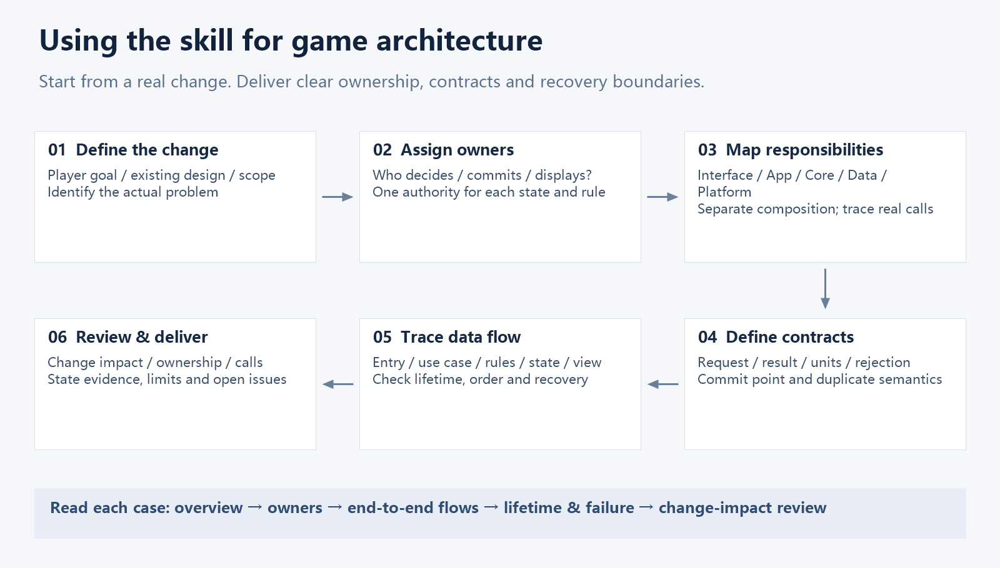
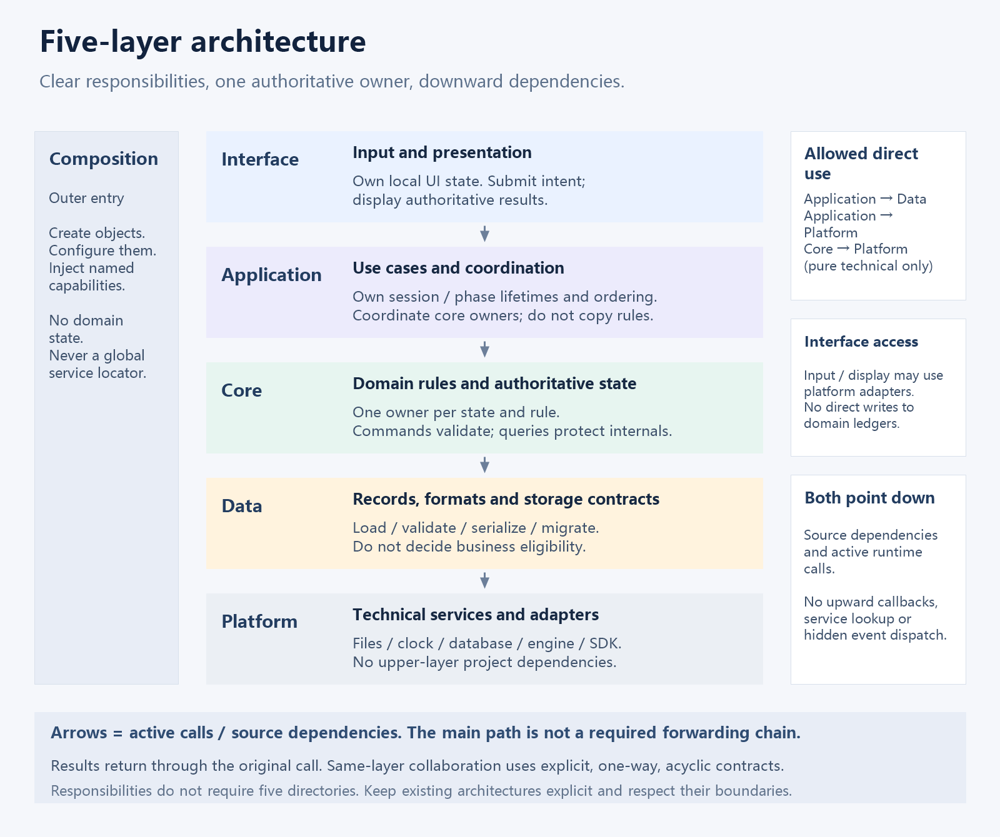

# Architecture First Coding

[Chinese version](README.zh-CN.md) · [Original skill (Chinese)](skills/architecture-first-coding/SKILL.md) · [Architecture examples](examples/README.en.md) · [MIT License](LICENSE)

A coding-agent skill for designing game architecture and other software before implementation. Establish responsibilities, authoritative state owners, concrete contracts, lifecycle and dependency direction, then assess the implementation against those decisions.

This repository contains the original skill, supporting references and architecture-only case studies from two Godot games: **Ember Garden · Twenty Waves** and **Neighborhood Mall**. The case studies contain explanatory text, responsibility tables and architecture images. No game implementation, runnable models, pseudocode or execution scripts are included in the current tree.

## Understand the workflow

Read [how to apply the skill](examples/README.en.md), then follow either complete case study. This introduction, the English case studies and their diagrams are entirely in English. The original skill instructions and supporting references are maintained separately in Chinese.

| Case study | Whole-game coverage | Decisions to look for |
| --- | --- | --- |
| [Ember Garden · Twenty Waves](examples/survivor/README.en.md) | Session phases, combat orchestration, actors, encounters, equipment, rewards, economy, profiles, queries and traces | Separate orchestration from rule ownership; restore a wave without rewinding the attempt identity; share authoritative results with presentation |
| [Neighborhood Mall](examples/mall/README.en.md) | Operating session, facilities, routes, ledger, staff, admissions, visits, transport, progression, events and persistence | One owner per business state; validate construction at confirmation; separate simulation progress, display animation and save completion |

## Core design choices

- Each state and rule has one authoritative owner. Views submit intent and display authoritative results.
- Source dependencies and runtime calls both matter. Callbacks and event buses can hide upward dependencies.
- Cross-module work needs concrete contracts, lifecycle and failure semantics before implementation.
- Shared capabilities belong at a legitimate layer; avoid writable global contexts and duplicated formulas.
- Third-party selection considers compatibility and licensing for the intended target and distribution.
- Scale the design to the change. Five responsibilities do not require five empty directories.

The default is a **strict downward five-layer architecture**: interface → application → core → data → platform. Storage contracts live in the data layer. This differs from architectures where data adapters implement domain-declared ports. Existing architectures should be mapped and respected. See the [original dependency reference (Chinese)](skills/architecture-first-coding/references/layered-architecture.md).

Arrows show active calls or source dependencies. The side notes identify allowed direct access; returning a requested result does not create an upward business call. Composition stays outside the five layers.

## Install and use

Download or clone this repository. Copy only the folder named architecture-first-coding inside skills into your personal Codex skills directory: the skills subdirectory of CODEX_HOME, or the skills subdirectory inside your home folder's .codex directory when CODEX_HOME is unset. Back up an existing customized installation before replacing it.

Ask your agent to use **$architecture-first-coding** when designing or reviewing a change. For example, request an architectural design for wave restoration, or review the ownership and failure boundaries of a construction transaction. The case studies show what the resulting architecture deliverable should explain; they are not mandatory templates for every small edit.

Other agents supporting SKILL.md can use the package through their own discovery mechanisms.

## Scope of the examples

The diagrams group related capabilities and show responsibility boundaries. They are not exhaustive import graphs, class diagrams or claims that every line in the original projects has passed a new architecture audit. They are based on the relevant specifications, composition and ownership boundaries inspected on 2026-11-21. Each case study states its evidence and limits.

The original skill and its four reference files remain unchanged. Contributions should keep examples focused on architecture and explain an observable ownership, dependency, lifecycle or recovery decision.

## License

The skill, documentation and original architecture diagrams in this repository use the [MIT License](LICENSE). Game implementation, assets, content tables, saves and third-party research material are outside this distribution.
