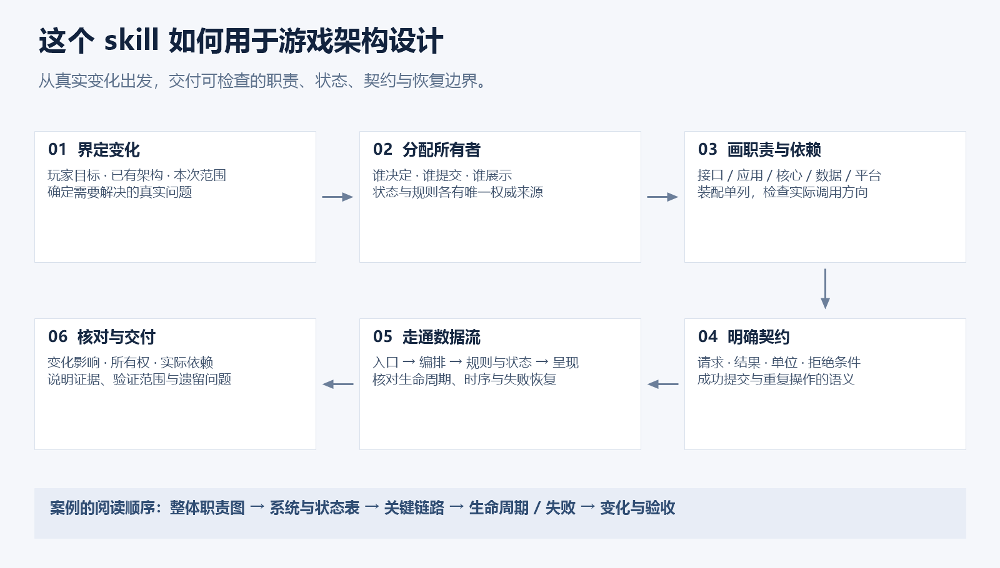

# 先设计架构，再处理代码

[English](README.md) · [完整 Skill](skills/architecture-first-coding/SKILL.md) · [如何使用与案例入口](examples/README.md)

一个适用于游戏及其他软件的 coding agent skill。先明确职责、权威状态所有者、具体契约、生命周期和依赖方向，再据此实现和验收。

本仓库保留原版 skill 与四份参考文档，并用《余烬庭院 · 二十波》和《街坊商场》的**整体架构**展示它如何落地。案例只包含架构文字、职责表和图片。

## 两个完整案例

| 案例 | 覆盖范围 | 可以学到的设计决定 |
| --- | --- | --- |
| [余烬庭院 · 二十波](examples/survivor/README.md) | 单局阶段、战斗编排、实体与遭遇、装备、效果、奖励、经济、局外资料、查询和轨迹 | 编排与规则分开；状态只有一个所有者；检查点与重开身份分开；表现消费已确认结果 |
| [街坊商场](examples/mall/README.md) | 经营会话、设施与通路、账本、员工、客流、行程、交通、成长与事件、存档 | 多个业务所有者如何协作；报价与确认如何分工；经营时间、动画时间与保存完成如何区分 |

每个案例都从游戏目标讲到整体分层图、系统与状态表、关键链路、生命周期、失败恢复、变化影响和验收问题。它们展示 skill 的设计产物，不要求所有小改动照搬整篇文档。

## 核心约束

- 状态与规则各有唯一权威所有者；UI 转换输入、展示权威结果。
- 默认按接口、应用、核心、数据、平台五层职责设计，源码依赖和主动调用都不能向上。
- 跨模块修改先明确请求、结果、单位、拒绝条件及提交时机。
- 共用能力有合法归属，不靠全局可写对象或复制公式共享规则。
- 三方库接入前核对目标平台、版本与许可要求。
- 工作量与改动规模匹配，不为了五层制造空壳目录。

这里采用严格向下的分层，存储契约归数据层。现有项目有明确架构时先做职责映射，具体允许关系见[五层参考](skills/architecture-first-coding/references/layered-architecture.md)。

## 安装与调用

下载或克隆仓库后，只将 skills 下的 architecture-first-coding 文件夹复制到个人 Codex skills 目录。配置了 CODEX_HOME 时使用其 skills 子目录；未配置时使用用户主目录下 .codex 的 skills 子目录。替换已有安装前先备份自己的修改。

对代理直接说明“使用 $architecture-first-coding”，并描述要设计或评审的范围。例如，请它设计波次恢复的状态和生命周期边界，或评审商场建造的报价、确认、占格和扣款链路。

具体如何把需求转为可检查的架构，见[案例阅读指南](examples/README.md)。

## 案例边界

这些图是按能力分组的职责图，未穷举全部源码依赖或运行时边。案例基于 2026-11-21 对有效规格、装配和相关所有者的只读核对，不等于完整代码审计或两个游戏的新一轮运行验收。

原版 skill 五份文件未修改。当前发布目录不包含游戏实现、可运行模型、伪代码、测试或运行脚本。skill、说明与原创架构图采用 [MIT 许可证](LICENSE)，游戏素材、数值表、存档及第三方研究资料不包含在本次发布中。
