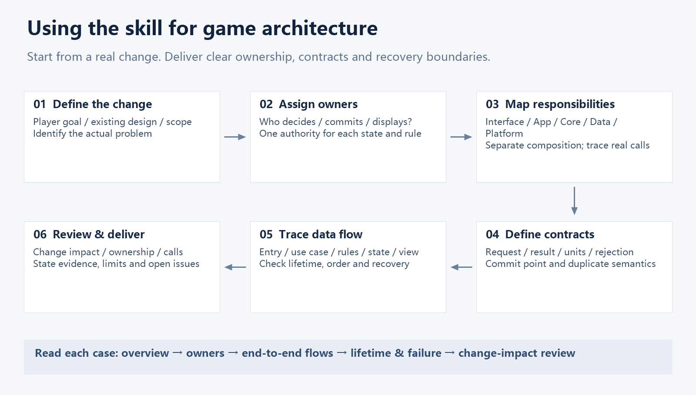

# Understanding the skill through two games

[Ember Garden · Twenty Waves](survivor/README.en.md) · [Neighborhood Mall](mall/README.en.md) · [Chinese version](README.md) · [Repository](../README.md)

Start with the whole-game responsibilities and state owners. Follow a player operation across those boundaries, then consider which responsibilities would change for a new feature. These examples contain architecture explanations and diagrams only.

## 1. Define the change

Tell the agent the goal, existing architecture and scope. A survival game might need to restore the current wave; a management game might need to save after construction. The skill helps establish the actual change before listing systems.

Both examples use the same five-layer constraints. Ember Garden organizes work around run phases and fixed-step combat. Neighborhood Mall organizes work around continuous operation, multiple business owners and recovery.

## 2. Assign authoritative owners

Ask who decides, who commits and who displays. Actor health belongs to the actor core; the run phase belongs to the session. Cash belongs to the ledger; the selected save slot belongs to the operating session.

Shared access does not grant shared write authority. Nor does it require combining every state into one manager. Focus, selection and animation queues can remain local to the interface because they have different lifetimes.

## 3. Establish layers and allowed dependencies

The interface translates input; applications coordinate use cases; the core owns rules and authoritative state; data capabilities manage records and formats; the platform provides technical services. The outer composition entry creates objects and injects their required capabilities.

Arrows in the diagrams indicate active calls or queries. Returning a requested result is not an upward business call. Higher layers obtain confirmed data for feedback. Grouping modules into a capability family does not permit unrestricted dependencies within that family.

## 4. Make contracts concrete

| Contract concern | Wave restoration | Construction confirmation |
| --- | --- | --- |
| Request | Restart the current failed wave | Confirm a facility and location |
| Required context | Current phase, opening checkpoint and attempt identity | Facility identity, coordinates and quote revision |
| Authoritative submission | Session coordinates; each core owner restores its state | Operating core coordinates floor and ledger |
| Success | Restored state and phase, plus feedback reset information | New facility, authoritative cost, balance and revision |
| Rejection or failure | Wrong phase or unavailable checkpoint | Stale revision, invalid space or insufficient funds |
| Duplicate semantics | After restoration, the combat phase rejects another restart | The old revision is rejected after commitment, without another debit |

These are natural-language contract summaries, not implementation or a complete interface inventory.

## 5. Trace the complete flow

Follow the player operation through entry, coordination, rules, state commitment, records and presentation. Check order and failure boundaries: payment feedback follows a committed sale; restoration uses a captured opening; a failed save does not automatically roll back a committed business action.

## 6. Test the design against changes and evidence

Would replacing the HUD require rewriting damage rules? Would adding a facility require price calculations in every panel? Would changing storage require the ledger to understand file operations? Such coupling is a reason to revisit the boundaries.

Architecture verification considers source dependencies, actual calls, state and rule ownership, lifecycle and failure recovery. A tidy directory tree or passing checks alone cannot establish architectural correctness.

## Mapping the skill to deliverables

| Skill requirement | Deliverable in these examples |
| --- | --- |
| Responsibilities and layers | Whole-game diagram, layer table and composition boundary |
| Authoritative ownership | System/state tables and separate lifetimes |
| Concrete contracts | Request context, results, rejection conditions and submission order |
| Allowed dependencies | Downward calls, explicit coordination and narrow queries |
| Failure recovery | Checkpoints, stale confirmations, failed saves and validated restoration |
| Verifiable design | End-to-end flows, change impact and review questions |

## Evidence and limits

The case studies draw on the projects' active specifications and selected implementation boundaries inspected on 2026-11-21. They cover composition, use-case entry points and important state owners, rather than auditing every dependency. The diagrams are explanatory aggregate views. This documentation does not claim full architectural compliance or a new runtime regression pass for either game.
