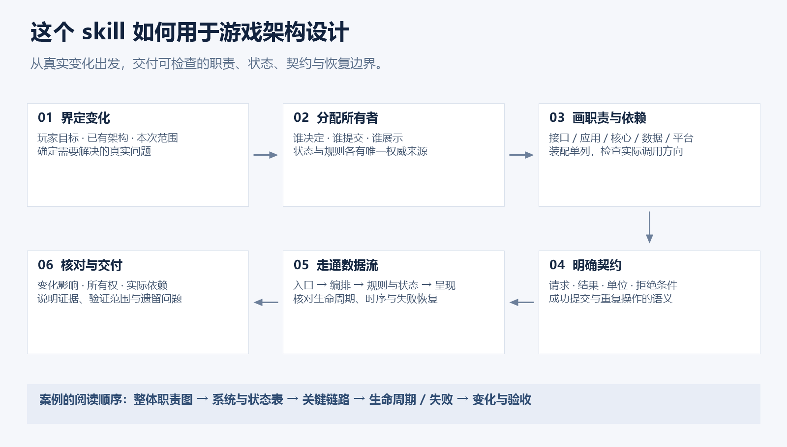

# 用两个游戏理解这个 skill

[余烬庭院 · 二十波：整体架构](survivor/README.md) · [街坊商场：整体架构](mall/README.md) · [返回仓库](../README.zh-CN.md)

先看整体职责与状态所有者，再沿一条玩家操作理解模块如何合作，最后看新增功能会影响什么。案例只发布架构说明与图片，不包含实现或伪代码。

## 第一步：确定要解决的变化

向代理说明当前目标、已有架构和这次变化。例如：生存游戏需要支持本波恢复；经营游戏需要允许建造确认后保存。skill 首先帮助限定变化范围，而不是先列一份通用系统名单。

两个案例采用同一套五层约束，但系统分工不同：前者围绕单局阶段与固定步战斗组织，后者围绕持续经营、多个业务账本及恢复组织。

## 第二步：找到唯一所有者

先问“谁决定、谁提交、谁展示”。例如，生命归实体核心，单局阶段归会话；现金归账本，当前存档槽归经营会话。共享不意味着各方都能写，也不意味着把所有状态合并到一个管理器。

阅读每个案例的状态表，检查新需求是否会产生第二个权威副本。界面选中项和动画队列有自己的生命周期，可以由界面持有。

## 第三步：确定层级与合法依赖

接口转换输入，应用编排用例，核心计算规则和提交领域状态，数据管理记录与格式，平台提供技术能力。启动装配在最外侧创建和注入对象。

图中的箭头表示主动调用或查询方向。下层返回请求结果不是主动向上调用；界面需要反馈时，由上层读取已经确认的数据。图中将多个模块聚合为系统族，不表示同层模块可以任意互相访问。

## 第四步：写出可检查的契约

无需写实现，也能把契约讲具体：

| 需要说清的事 | 波次恢复 | 建造确认 |
| --- | --- | --- |
| 请求 | 重开当前失败波次 | 确认目标设施与位置 |
| 必需上下文 | 当前阶段、当前波次检查点、尝试身份 | 设施身份、坐标、报价对应的经营修订 |
| 权威提交者 | 会话组织恢复，各核心恢复自己的状态 | 经营核心协调地图与账本 |
| 成功结果 | 已恢复的阶段与状态、表现重置信息 | 新设施、权威费用、余额与新修订 |
| 拒绝或失败 | 阶段不允许、检查点不可用 | 修订过期、空间无效、资金不足 |
| 重复语义 | 成功后已回到战斗，重复重开不再次生效 | 已提交后的旧修订拒绝，不重复扣款 |

这些是自然语言契约，不代替项目的完整接口清单。

## 第五步：走通整条数据流

从玩家操作出发，追踪入口、编排、规则、状态提交、资料处理及呈现。重点看顺序和失败边界：已经入账的成交才产生付款表现；已捕获的开场才可恢复；保存失败不自动等于业务提交回滚。

## 第六步：用变化和验收反查设计

用真实变化检验分工：换 HUD 是否需要重写伤害？新增设施是否需要改每个面板的价格公式？换保存介质是否需要让账本认识文件 API？出现这些牵连时应重新检查边界。

验收同时看源码边界、实际调用、状态与规则所有权、生命周期和失败恢复。目录整齐或检查全绿都不能单独证明架构合理。

## 这两个案例如何对应 skill

| skill 要求 | 案例中的设计产物 |
| --- | --- |
| 职责与层级 | 整体架构图、五层职责表、装配边界 |
| 唯一权威所有者 | 系统与状态表、独立生命周期 |
| 具体契约 | 请求内容、结果、拒绝条件与提交顺序 |
| 允许依赖 | 向下的主动调用、同层协调者和窄查询入口 |
| 失败恢复 | 波次检查点、过期确认、保存失败和恢复替换 |
| 可验证的设计 | 关键链路、变化影响和架构验收问题 |

## 证据与限制

案例来自两个项目当前有效规格和相关实现的只读核对，核对日期为 2026-11-21。重点检查装配、用例入口和关键状态归属，未逐条审计所有依赖；图中分组是便于解释的整体视图。案例不宣称原项目已经完全符合 skill，也不宣称本次进行了游戏运行回归。
