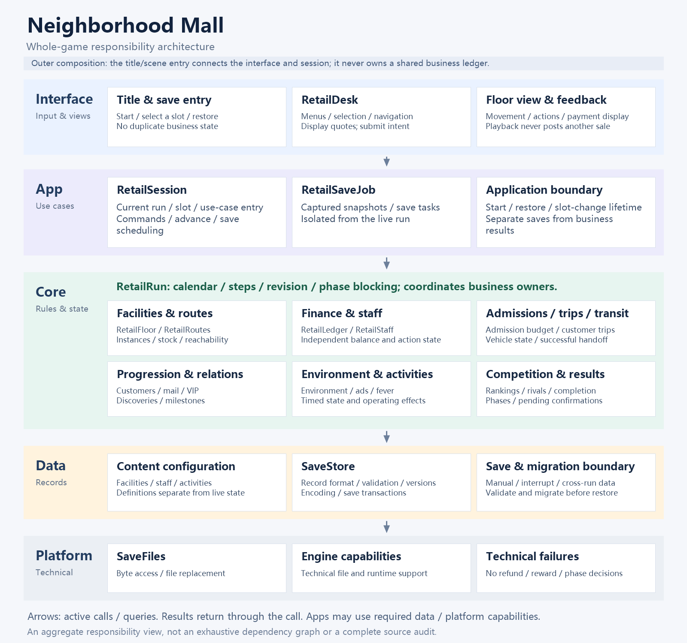

# Neighborhood Mall: whole-game architecture

[Applying the skill](../README.en.md) · [Ember Garden · Twenty Waves](../survivor/README.en.md) · [Chinese version](README.md)

Neighborhood Mall is the English rendering of the project's current title. This case study covers its active, directly operated mall game. Continuous operation connects facilities, routes, stock, staff, customers, transport, progression, events and finance. The architecture assigns those states to explicit owners and separates player operations, simulation, presentation and persistence.

This is architecture documentation only, with no implementation, pseudocode, content tables or source-game research material.

## Whole-game responsibility diagram

Arrows show active calls or queries at the diagram's level of aggregation. Receipts and snapshots return through the original call. Core groups do not enumerate every same-layer dependency or permit unrestricted mutual access. Applications may use storage directly when required by a use case; forwarding through every layer is unnecessary.

## Five layers derived from operation

| Layer | Main responsibilities | Boundary |
| --- | --- | --- |
| Interface | Title/save entry, RetailDesk, floor view, menus, feedback and animation | Own focus, placement selection, navigation and playback; display snapshots without posting transactions |
| Application | RetailSession and save jobs | Manage the current run, slot, start/restore, commands, advancement and save scheduling without duplicating business rules |
| Core | RetailRun coordinates operating steps, calendar, blocking phases and submissions; domain capabilities own their state | Animation completion and page refresh cannot implicitly commit business actions |
| Data | Facility/staff/activity configuration; SaveStore record format, validation, versions and save transactions | Definitions do not own live facility instances; storage does not decide eligibility |
| Platform | SaveFiles and technical file/engine capabilities | Handle bytes and technical failures without deciding refunds, rewards or operating phases |

The title/scene entry is the outer composition boundary connecting the interface, session and required capabilities. Assembly does not make it a shared business ledger.

## Why session and operating run are separate

| Owner | Authoritative scope | Responsibility kept elsewhere |
| --- | --- | --- |
| RetailDesk | Current page, focus, selection, return path and local presentation | Cash, facility state, operating month or reward claims |
| RetailSession | Current run reference, selected slot and manual/interrupt save scheduling/status | Facility prices, admission eligibility or staff action rules |
| RetailRun | Period/week/step, revision, phase blocking and cross-capability order | Floor, ledger, staff and progression internals |
| RetailSaveJob | Captured snapshots, pending writes and save-window identifiers | Mutating the live run from the worker or manipulating UI |

How a mall operates is separate from where and when its data finishes saving. Save jobs use captured data; the interface reads save status. A storage receipt does not authorize a lower layer to invoke upper-layer business callbacks.

## Core systems and state owners

| Capability family | Representative owners | Authoritative state or rules |
| --- | --- | --- |
| Facilities/construction | RetailFloor | Facility instances, occupancy, blueprint allowance, construction, growth, stock and related quotes |
| Routes | RetailRoutes | Walkways, stairs, connectivity and reachability, consumed through explicit capabilities |
| Finance | RetailLedger | Cash, hearts, points and classified monthly/yearly transactions; reports derive from the same ledger |
| Staff | RetailStaff | Live staff state, assignments, actions, targets and work progress; the operating run coordinates effects across owners |
| Admissions/trips | RetailAdmissions, RetailTrips and customer entry/exit/motion capabilities | Admission budget/statistics, selection, trips and phases; visible character nodes do not decide whether visits/payments happened |
| Transport | RetailTransport and vehicle action capabilities | Vehicle operation, passengers and phases with explicit successful handoff points |
| Progression/relationships | RetailProgression, RetailVip, RetailMilestones | Customer records, mail, discoveries, VIP and milestone state, each with its owner |
| Environment/activities | Environment, ads, fever and activity capabilities | Timed effects and business rules, separate from content definitions |
| Competition/results | RetailRanking, RetailRival, RetailSaleBattle, RetailYearEnd and related owners | Ranking, competition, event results, year-end/completion phases and pending confirmations |

Families may contain several independent owners; grouping does not require a single class. Same-layer relationships still have direction. RetailRun coordinates floor and ledger; floor capabilities can consume route rules. These relationships do not imply universal mutual ownership.

## Four end-to-end flows

### Construction: quote, placement and payment

The interface selects a facility and location, then obtains a core quote through the session. That quote reflects space, eligibility and funds at that time. Confirmation includes the facility, coordinates and operating revision. RetailRun validates current state again before coordinating placement and ledger payment, then advances the revision.

The interface displays the authoritative cost. Stale confirmation, invalid occupancy and insufficient funds cannot appear as successful construction. Reusing the old revision cannot debit twice. This is a single-player synchronous submission contract, not a cross-process network idempotency protocol.

### Operation: admissions, sales and presentation

The session requests advancement under operating conditions. RetailRun coordinates admissions, trips, arrival, service, stock and settlement. Each capability owns its phase and data, while coordination follows established facts. Stock and financial changes commit in business order.

Only a posted sale becomes payment feedback. The floor view may queue movement segments or combine nearby payment displays, but animation completion cannot post another sale. Restored presentation starts from the current trip state rather than replaying business transactions.

### Calendar: simulation and display time

RetailRun owns the calendar and step position. Valid operating steps advance construction, staff, admissions, restocking, fees and progression. Pending results can block operating advancement. Navigation, redraw and chart refresh do not themselves advance accounts.

Some mechanics have explicit presentation-advance contracts, such as visible-frame updates of a VIP queue. Preserve that distinction from ordinary operating steps and identify the owner and application entry. A single universal timer would hide different lifetimes.

### Save/restore: consistent snapshots and run replacement

The session captures snapshots at defined boundaries and coordinates manual, interrupt and required system records. Save jobs consume captured data. The data layer handles encoding, validation and save procedures; the platform performs file operations.

Restoration validates and migrates data before creating or replacing the active run, rather than partially overwriting live operation. An ordinary save failure does not automatically undo a committed in-memory action. Some cross-run actions require successful persistence before confirmation; each has its own submission order rather than a universal failure policy.

## Contracts and failure boundaries

| Request | Required context | Result and rejection boundary |
| --- | --- | --- |
| Construction quote | Facility, floor/column and current business conditions | Authoritative price/eligibility without committing placement or payment |
| Operating command | Action, necessary parameters and operating revision | Validate phase, eligibility and resources before committing; stale revisions or pending results can reject |
| Advancement | Elapsed time, pause/pending conditions and motion capture requirement | Operating rules determine advancement; redraw is not a time commit |
| Save | Slot, record kind, captured snapshot and save-window context | Success or technical failure, respecting that operation's commit order |
| Restore | Slot, target mode and validated/migrated data | Replace the run on success; invalid data does not partially become live state |

These are architectural contract summaries, not a complete error catalog, file format or implementation.

## Lifetimes

| Scope | State or resources | Boundary requirement |
| --- | --- | --- |
| Scene/interface | Return stack, selection, popups and playback | Reopening or closing a view does not repeat charges, rewards or sales |
| Session | Current run, slot and save scheduling | Handle existing save work when switching slots or closing; receipts must match the relevant window |
| Mall run | Floor, ledger, staff, customers, calendar and progression | Save/restore through owners; presentation does not receive writable copies |
| Step/action | Staff/customer actions, transport handoffs and facts | Core owns sequencing; playback cannot change commit time |
| Save job | Captured snapshot, pending operations and window identity | Isolate from the live run; do not leak writable run objects to workers |
| Across runs | Inheritance, unlocks and system progression | Separate from ordinary run saves, with ordering owned by the relevant use case |

## How the skill shapes this design

1. Derive floor, ledger, staff, trip and progression ownership from business objects and player operations.
2. Place session lifetime in the application, operation/rules in the core and local display state in the interface.
3. Specify when construction, sales, confirmations and saves become valid rather than assuming one universal transaction.
4. Separate configuration, save format and technical file access so storage gains no business decision authority.
5. Review stale confirmations, save failure, slot changes and delayed playback instead of merely checking five directories.

## Change-impact checks

| Change | Primary impact | Warning sign |
| --- | --- | --- |
| New facility category | Data definitions, facility rules and coordination | Independent price, stock or income formulas across panels |
| New floor/popup presentation | Interface layout and projections | Animation callbacks post transactions or advance operation |
| New transport type | Vehicle state/actions and handoff contract | Display nodes create customers already counted as admitted |
| New financial report | Ledger queries and interface charts | Another independently maintained transaction history |
| New storage medium | Session save boundary, data and platform | Ledger/floor understanding file paths or UI windows |

## Evidence and review questions

The case study uses the active directly operated game specification and architecture plan, with selected checks of title entry, RetailSession, RetailRun, RetailFloor, save jobs, SaveStore and file capabilities. Inspection date: 2026-11-21. No complete source audit, natural-operation regression or full save/restore regression was performed.

Review whether cash and transactions have one authority, quotes remain read-only, stale commands reject, stock/sales/payment order is consistent, playback is separate from commitment, and slot changes or failed saves respect their lifetimes. A reasonable layer diagram does not replace that behavioral evidence.
