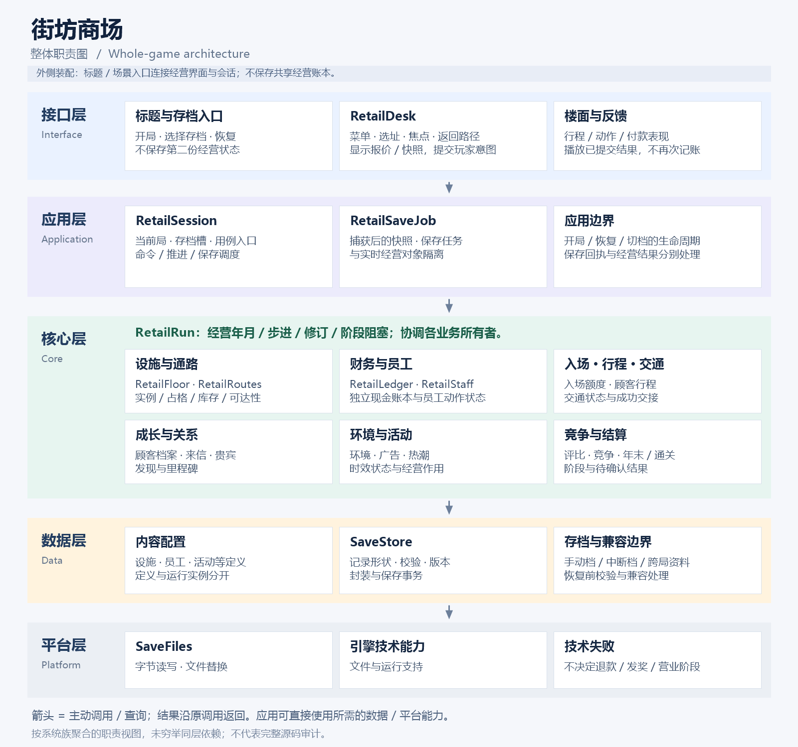

# 《街坊商场》整体架构

[如何使用这个 skill](../README.md) · [余烬庭院 · 二十波案例](../survivor/README.md)

这是持续推进的直营商场经营游戏。设施、通路、库存、员工、顾客、交通、成长、活动和财务相互影响，架构的重点是让这些状态拥有明确归属，并把玩家操作、营业推进、表现播放和资料保存分开。

本案例以当前正式直营版本为范围。只解释架构，不包含实现、伪代码、内容目录或原作研究资料。

## 整体职责图

箭头表示图示粒度的主动调用或查询方向；回执和快照是原调用结果。核心区按业务能力分组，未绘制全部同层依赖，不表示这些模块可以任意互调。应用直接使用存档能力属于其明确用例，不需要为凑齐五层增加转发。

## 从经营目标到五层

| 层级 | 主要职责 | 关键边界 |
| --- | --- | --- |
| 接口 | 标题与存档入口、RetailDesk、楼面显示、菜单弹窗、反馈与动效 | 持有焦点、选址、返回路径和播放进度；展示经营快照，不直接记账 |
| 应用 | RetailSession 与保存任务 | 管理当前局、存档槽、开局/恢复、命令、推进与保存调度；不复制经营规则 |
| 核心 | RetailRun 协调经营步、年月阶段和确认顺序；各业务能力持有自己的权威状态 | 业务提交与效果由核心确定，不能由动画结束或页面刷新隐式触发 |
| 数据 | 设施、员工、活动等配置；SaveStore 记录形状、校验、版本与保存事务 | 内容定义不直接持有运行中设施；存储不决定业务资格 |
| 平台 | SaveFiles 等文件与引擎技术能力 | 处理字节和技术失败，不决定退钱、发奖或继续营业 |

标题/场景入口位于最外侧，创建和连接经营界面、会话及其所需能力。它可以完成装配，但不因此成为共享经营账本。

## 经营会话与经营局为什么分开

| 所有者 | 权威范围 | 不应混入的职责 |
| --- | --- | --- |
| RetailDesk | 当前页面、焦点、选择、返回路径和局部表现状态 | 第二份现金、设施状态、经营月份或奖励领取记录 |
| RetailSession | 当前经营局引用、存档槽、手动/中断保存的调度与状态 | 重新判断设施价格、客流资格或员工动作规则 |
| RetailRun | 经营期、周/营业步位置、修订、阶段阻塞与跨业务提交顺序 | 吞并地图、账本、员工和成长能力内部所有权 |
| RetailSaveJob | 捕获后的待写快照、工作任务与保存窗口相关标识 | 让工作线程回写正在变化的经营对象或操作 UI |

这使“当前这局正在怎样经营”和“这局保存到哪里、何时完成”成为不同问题。保存任务接收快照，界面读取保存状态；存储回执不能直接驱动上层业务回调。

## 核心系统与状态所有者

| 能力族 | 代表所有者 | 权威状态或规则 |
| --- | --- | --- |
| 设施与建设 | RetailFloor | 设施实例、占格、图纸余量、建设/成长/库存等设施状态和相应报价 |
| 通路 | RetailRoutes | 走道、楼梯及连接、可达性等路径规则；设施通过明确能力使用这些结果 |
| 财务 | RetailLedger | 现金、爱心、点数及分类月年收支；报表从同一交易口径派生 |
| 员工 | RetailStaff | 员工配置后的运行状态、排班/动作/目标和工作进度等；经营局按事实提交跨能力效果 |
| 入场与行程 | RetailAdmissions、RetailTrips 及顾客进出/动作能力 | 入场额度与统计、行程、选客及行程阶段；不由显示角色节点决定是否已经到访或付款 |
| 交通 | RetailTransport 与交通动作能力 | 交通运行、载客与相关阶段；与经营局的顾客交接有明确提交点 |
| 成长与关系 | RetailProgression、RetailVip、RetailMilestones | 顾客档案、来信/发现、贵宾和成长里程碑等各自状态 |
| 环境与活动 | 环境、广告、热潮与活动相关能力 | 作用于经营的时效与规则，内容定义和运行状态分开 |
| 竞争与结算 | RetailRanking、RetailRival、RetailSaleBattle、RetailYearEnd 等 | 评比、竞争、事件结果、年末/通关阶段及待确认结果 |

每个能力族可包含多个独立所有者；表格不是要求将它们合并成一个类。同层关系也有方向，例如经营局协调地图与账本，地图可使用通路能力；不能将这种协作推广为所有模块相互持有。

## 四条贯穿整体的链路

### 建造：从报价到占格与扣款

界面选择设施和位置，经会话取得核心报价。报价表达当时的空间、资格和资金结果。玩家确认时携带设施、坐标及对应经营修订；经营局重新校验当前状态，再协调地图放置与账本扣款，成功后更新经营修订。

界面展示权威费用，不重新计算。过期确认、无效占地或资金不足都不能被显示成成功建设。重复旧确认受修订约束，不会第二次扣款；这属于当前单机同步提交契约，不等于跨进程网络幂等协议。

### 营业：从客流到成交与表现

会话按经营条件请求推进，经营局组织入场、行程、到店、服务、库存与结算。各能力持有自己的阶段和数据；经营局根据已成立事实协调下一项操作。门店库存与财务结果按业务顺序提交。

已经入账的成交才进入动作/付款反馈数据。楼面显示可以排队播放路段、合并近同时的付款表现，但不能因为动画结束再记一笔销售。读档后的角色显示应从当前行程恢复，不能靠重放表现重新触发成交。

### 周/月推进：把经营时间和显示时间分开

经营局持有年月周与步进位置，按有效营业步推进施工、员工、客流、补货、费用和成长事件。需要确认的结果可以阻塞经营推进；界面返回、窗口重绘和图表刷新本身不应推进经营账目。

部分玩法有专门的表现推进契约，例如贵宾队列的可见帧更新。应保留它与普通营业步的区别，明确其核心所有者和应用入口，不能把所有游戏状态都简化成同一个计时器。

### 保存与恢复：从一致快照到替换当前局

会话在明确边界捕获经营快照，并协调手动档、中断档及必要的系统资料。保存任务使用捕获后的数据，数据层负责封装、校验与保存流程，平台执行文件操作。

恢复先完成数据校验和必要兼容处理，再建立/替换当前运行对象；不能逐字段污染正在经营的局。普通保存失败时，已提交的内存经营结果不会自动撤销；个别跨局资料必须先保存再确认的操作有独立的提交顺序，不能套用同一个失败规则。

## 契约与失败边界

| 请求 | 必需上下文 | 权威结果与拒绝边界 |
| --- | --- | --- |
| 查询建设报价 | 设施身份、楼层与列等位置、当前经营条件 | 返回权威费用和可否建设；查询不提交建设或费用 |
| 确认经营命令 | 动作、所需参数、经营修订 | 核心校验阶段、资格和资源后提交；旧修订或未处理结果可能拒绝 |
| 请求推进 | 经过时间、经营暂停/待确认状态、是否采集动作投影 | 固定经营规则决定推进；界面刷新不等价于时间提交 |
| 保存 | 当前槽位、档类型、已捕获快照及保存窗口上下文 | 返回成功或技术失败；提交顺序按该操作约定处理 |
| 恢复 | 存档槽、目标模式、通过校验和兼容处理的数据 | 成功后替换当前局；无效数据不能作为部分经营状态生效 |

这是跨模块契约摘要，不包含完整错误码、文件格式或实现细节。

## 生命周期

| 范围 | 持有内容 | 边界要求 |
| --- | --- | --- |
| 场景/界面 | 返回栈、选中设施、弹窗和动作播放 | 关闭或重建界面不重新扣款、发奖或成交 |
| 经营会话 | 当前局、槽位、保存调度 | 切档与关闭时处理既有保存任务，避免回执作用于错误窗口 |
| 一局商场 | 地图、账本、员工、顾客、年月与成长 | 每类状态通过自己的能力保存与恢复；显示不能持有可写副本 |
| 经营步/动作 | 员工和顾客动作、交通交接、业务事实 | 时序由核心决定，表现播放不能篡改提交时点 |
| 保存任务 | 捕获快照、待写操作与窗口标识 | 和实时经营状态隔离，不向工作线程泄漏当前局的可写对象 |
| 跨局资料 | 继承、解锁和系统级进度 | 与普通经营档区分，具体提交先后由所属用例明确 |

## skill 在这里如何发挥作用

1. 从经营对象和玩家操作出发，先区分地图、账本、员工、行程与成长的权威所有者。
2. 将会话生命周期放在应用层，持续经营和领域规则放在核心层，界面只保留展示状态。
3. 对建造、销售、阶段确认、保存分别写清结果何时成立，避免一个万能事务假设。
4. 将配置记录、存档格式与平台文件操作分开，防止底层保存能力获得经营决策权。
5. 用旧确认、保存失败、切档和动画积压检验边界，而不是仅检查是否建立了五个目录。

## 用变化检验架构

| 变化 | 应主要影响 | 需要警惕 |
| --- | --- | --- |
| 新增一类设施 | 数据定义、设施规则及相关经营协调 | 多个页面分别算价格、库存或收益 |
| 更换楼面/弹窗表现 | 接口布局与投影 | 动画完成回调再次记账或推进业务 |
| 新增交通方式 | 相应交通状态/动作与经营交接契约 | 交通显示节点直接生成已入账顾客 |
| 调整财务报表 | 同一账本的查询投影与界面绘图 | 为报表维护第二套交易记录 |
| 更换保存介质 | 会话保存边界、数据存储与平台适配 | 账本和地图开始理解文件路径或 UI 窗口 |

## 核对依据与验收问题

本案例以当前直营规格和架构计划为依据，并核对标题入口、RetailSession、RetailRun、RetailFloor、保存任务、SaveStore 与平台文件边界。核对日期为 2026-11-21；未逐条审计所有模块，也没有重新执行自然营业或完整保存恢复回归。

验收时应继续追问：现金和交易是否只有一个权威来源？报价查询是否只读？旧命令是否拒绝？库存、成交与入账顺序是否一致？动作播放是否与业务提交隔离？切档和失败保存是否仍遵守既定生命周期？图中的合理分层不能代替对这些实际行为的验证。
