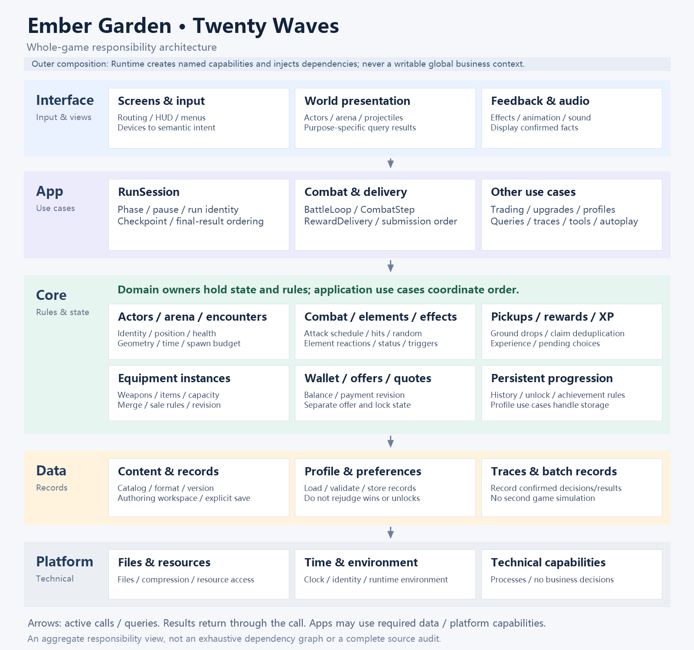

# Ember Garden · Twenty Waves: whole-game architecture

[Applying the skill](../README.en.md) · [Neighborhood Mall](../mall/README.en.md) · [Chinese version](README.md)

Ember Garden is a Godot survival game organized around twenty waves and choices within a run. Its architecture supports fixed-step combat, wave rewards, upgrades, shopping, equipment changes, failure recovery and persistent profiles. Presentation, feedback and debugging consume authoritative results.

The English game name follows the project's existing localization. This case study explains architecture only; capability names identify responsibilities without presenting implementation or pseudocode.

## Whole-game responsibility diagram

Arrows indicate active calls or queries at the diagram's level of aggregation. Snapshots, receipts and confirmed facts return through the original call. Capability families do not enumerate every same-layer dependency. Composition is an outer entry, not a writable global context. Applications may use required data or platform capabilities directly; every request need not traverse all five layers.

## Five layers derived from the game

| Layer | Main responsibilities | Boundary |
| --- | --- | --- |
| Interface | Screen routing, input, HUD, world presentation, feedback and audio | Submit intent and display results; do not duplicate health, inventory, price or balance authority |
| Application | Run session, combat steps, reward delivery, trading, upgrades, profiles, queries, traces and automated play | Coordinate phases and cross-owner ordering without copying core rules |
| Core | Actors, arena, encounters, attacks, hits, elements, effects, equipment, rewards, experience, wallet, offers and progression | Own domain state and rules through explicit collaboration |
| Data | Content catalog, records, authoring workspace, profile/preferences repositories, trace and batch-job records | Manage loading, formats, versions and storage; do not decide damage, eligibility or victory |
| Platform | Files, compression, resource access, time, identity, runtime environment and processes | Return technical results without reaching into run coordination or invoking upper-layer business logic |

Runtime is the outer composition entry. It creates named capabilities and injects what use cases and views need. Holding those instances for assembly does not grant authority to mutate their state or make Runtime a service registry for the rest of the system.

## Application responsibilities

| Capability | Owns or coordinates | Does not take over |
| --- | --- | --- |
| RunSession | Run identity, phase, pause, session tick, operation order, one final result and wave restoration entry | Mutable copies of actor health, equipment, balance or effects |
| BattleLoop | Fixed-step execution, wave boundaries, calls across core owners and combat checkpoint coordination | Encounter budgets, hit formulas or experience thresholds |
| CombatStep | Attack/hit submission order and confirmed feedback data | Damage decisions based on animation completion |
| RewardDelivery | Reward-plan validation, delivery to health/experience/wallet owners and confirmation order | Another balance or experience ledger |
| MarketService | Purchase, reroll, sale and merge transactions and receipts | Recalculating prices or editing inventory internals |
| ProgressionService | Growth choices and reroll use cases | Duplicate level or attribute rules |
| EquipmentLifecycle | Coordination of triggers, effects and scheduling when equipment changes | Inventory or effect ownership |
| ProfileService | Profile loading, result persistence and retry | Rejudging victory or duplicating unlock rules |
| Query capabilities | Purpose-specific rule, world, inventory and content views | A universal writable context |
| Traces, authoring and automated play | Recording, controlled changes, semantic input and batch execution | A second independent game simulation |

## Core state owners

| Capability family | Representative owners | Authoritative state or rules |
| --- | --- | --- |
| Actors | ActorSimulation | Identity, team, position, health and hit state; player and enemy policies produce intent using shared actor capabilities |
| Arena | ArenaGeometry | Geometry and spatial predicates such as passability and contact |
| Encounters | EncounterDirector | Wave time, spawn budget, entry plans and the relevant random stream; requests spawning without owning actor health |
| Combat | WeaponScheduler, ProjectileSimulation, HitResolver, CombatRandom | Attack scheduling, projectiles, hit rules and combat randomness, each within its responsibility |
| Effects | StatusEffects, GameplayTriggers, ElementalReactions and related owners | Effect lifetime, trigger eligibility, elemental attachment and reactions |
| Equipment | EquipmentInventory | Weapon/item instances, capacity, merge/sale constraints and inventory revision |
| Rewards | PickupField, RewardLedger | Ground pickups, carried rewards, eligibility, sampling, pending delivery and claim deduplication |
| Experience | LevelProgression | Level, remaining experience and pending growth choices |
| Economy | Wallet, ShopOffers | Balance/payment revision, and separate offer/lock/quote/shop-random state |
| Persistent progression | MetaProgression | History, unlock and achievement-related rules; persistence is coordinated by application/data capabilities |

A family is a reading aid, not necessarily one object. Reward delivery, for example, requires application coordination across recipients; the reward ledger does not gain permission to edit wallet or health internals.

## Three end-to-end flows

### Combat advancement

The input entry translates movement and actions into semantic intent. The session validates phase and pause state. Combat coordination advances encounters, actors, weapons, effects and hit resolution in fixed steps. Each core owner commits its own state. Queries and feedback expose confirmed results to the world view, HUD and audio.

Changing rendering should not change damage. Automated or batch execution should reuse the same use cases and core rules. Presentation time controls display rather than acting as an implicit domain clock.

### Wave rewards, upgrades and shopping

The session establishes wave-end ordering. Battle coordination performs cleanup and reward delivery. The reward ledger determines eligibility and plans; the delivery use case submits health, experience and currency to the appropriate recipients before confirming the result. Pending growth choices determine whether the session proceeds to upgrades or shopping.

The shop displays authoritative quotes. Trading coordinates offers, wallet, inventory and equipment lifecycle. Effective attributes and changing prices come from shared rule results; preview requirements do not justify another formula in the interface.

### Failure recovery and final profiles

The session enters a defeat choice and initiates restoration. BattleLoop coordinates restoration by combat owners, while the session restores its time, input and relevant facts. The opening checkpoint is captured after entry processing, so restoration does not repeat entry income.

Restart count and presentation identity remain outside the checkpoint because restored ticks and entity identifiers can repeat. On final completion, the session submits one result. Profile use cases handle persistence and retry without asking the interface to judge the outcome again.

## Contracts and failure boundaries

| Request | Required context | Result and rejection boundary |
| --- | --- | --- |
| Advance combat | Phase, fixed step and semantic input | Advance only when allowed; pause or screen redraw does not independently change combat state |
| Purchase an offer | Current offer/preview and inventory/payment context | Confirm current price and delivery conditions; stale or failed requests are not presented as purchases |
| Restart a wave | Defeat phase, opening checkpoint and attempt identity | Restore combat and reset presentation; phase rules reject duplicate or outdated requests |
| Submit a final result | Unique run result and profile submission context | Judge the ending once; retry persistence according to its existing contract |

This is an architectural summary, not a complete interface or error inventory.

## Lifetimes

| Scope | State or resources | Boundary requirement |
| --- | --- | --- |
| Startup/process | Composition, content, technical adapters and shared presentation services | Explicit initialization/release without implicit run resets |
| Run | Identity, phase, inventory, money, experience and core state | Create/reset through owners; do not submit the ending twice |
| Wave/attempt | Combat entities, wave state, checkpoint and input/fact range | Restore all relevant owners while keeping attempt identity outside the rewind |
| Frame/page | Focus, selection, animation, audio and feedback caches | Clear independently without pretending display cleanup restores business state |
| Across runs | Committed history, unlocks and preferences | Persist through profile/data capabilities; failed attempts are not final results |

## How the skill shapes this design

1. Use actual phase changes, duplicate rewards and restoration requirements to determine boundaries.
2. Assign authoritative health, equipment, balance, experience and phase owners before choosing files.
3. Give combat, trading and delivery their application responsibilities instead of expanding a universal session manager.
4. Define commit order, confirmed facts and duplicate semantics for cross-owner operations.
5. Assess checkpoints, shared queries and presentation lifetimes rather than judging the directory layout alone.

## Change-impact checks

| Change | Primary impact | Warning sign |
| --- | --- | --- |
| Add a weapon or elemental rule | Content, combat/effect owners and required lifecycle coordination | HUD damage formulas or divergent rules between entry points |
| Replace HUD/world presentation | Interface and feedback projection | Views holding writable actor references |
| Add state that must rewind | Its owner, checkpoint coordination and restoration contract | Missing random state, facts or derived-cache handling |
| Replace profile storage | Profile use case, repository and platform adapter | Core or interface depending on the new file format |

## Evidence and review questions

The case study uses the active capability-based architecture specification and related feature plans, with selected checks of Runtime, RunSession, BattleLoop, CombatStep and RewardDelivery. Inspection date: 2026-11-21. No complete source audit or new runtime regression pass was performed.

Review whether every rule has one source, owners validate commands, queries protect mutable internals, feedback follows commitment, actual calls avoid hidden upward dependencies, and restoration covers the relevant lifetimes. The diagram alone cannot establish those properties.
