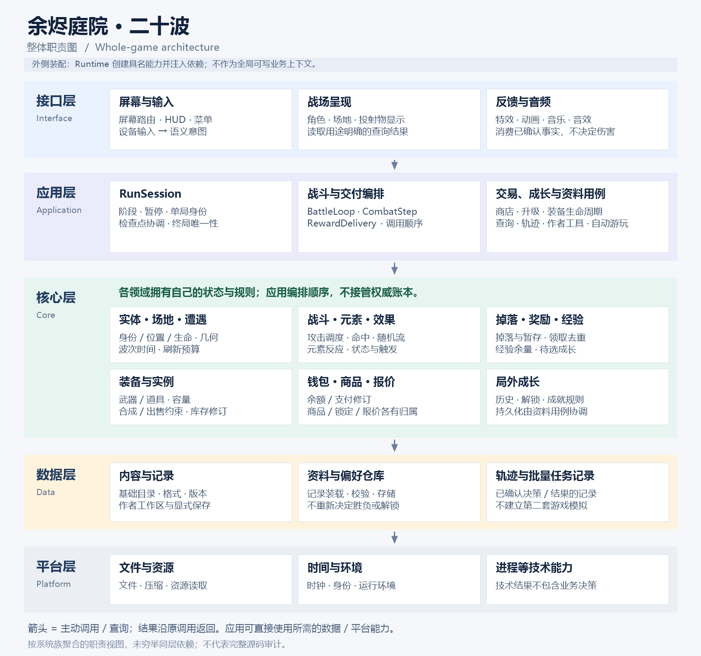

# 《余烬庭院 · 二十波》整体架构

[如何使用这个 skill](../README.md) · [街坊商场案例](../mall/README.md)

[English version](README.en.md)

这是围绕二十波生存与局内构筑组织的 Godot 游戏。架构需要同时支持固定步战斗、波末奖励、升级与商店选择、装备变化、失败恢复和局外资料，并让界面、反馈与调试功能使用同一份权威结果。

本案例只解释架构。模块名称用于定位职责，不包含源码、伪代码或完整接口签名。

## 整体职责图

实线箭头表示图示粒度的主动调用或查询方向。返回快照、回执和事实是原调用的结果通道。图按系统族聚合，不穷举同层依赖；装配入口位于最外侧，不是全局业务上下文。应用可按职责直接使用数据与平台能力，并非每次调用都必须走完五层。

## 从游戏目标到五层

| 层级 | 主要职责 | 关键边界 |
| --- | --- | --- |
| 接口 | 屏幕路由、设备输入、HUD、战场显示、反馈、音乐与音效 | 只提交语义意图并消费结果；不维护另一套生命、库存、价格或余额 |
| 应用 | 单局会话、战斗步骤、奖励交付、商店与升级用例、资料处理、用途明确的查询、轨迹与自动游玩用例 | 负责阶段和跨所有者顺序；不复制核心规则，也不靠全量服务字典访问内部对象 |
| 核心 | 实体、场地、遭遇、攻击与命中、元素与状态、装备、奖励、经验、钱包、商品、局外成长 | 各自持有权威状态和公式，通过明确关系协作 |
| 数据 | 基础内容目录、记录形状、作者工作区、资料与偏好仓库、轨迹和批量任务记录 | 管理加载、格式、版本与存储，不决定伤害、购买资格或胜负 |
| 平台 | 文件与压缩、资源读取、时钟、身份与运行环境、进程等技术能力 | 返回技术结果，不回查单局协调者或主动调用上层业务 |

Runtime 是最外侧装配入口：创建具名能力，将需要的窄能力交给用例和视图。它可以认识多层以完成装配，但不能成为被各层随意回查的容器，也不能因为持有多个实例就获得它们状态的写入权。

## 应用层怎样分工

| 应用能力 | 拥有或编排什么 | 不应接管什么 |
| --- | --- | --- |
| RunSession | 单局身份、阶段、暂停、会话 tick、操作顺序、终局唯一性、波次恢复入口 | 实体生命、武器实例、余额或效果的第二份权威状态 |
| BattleLoop | 一步战斗推进、波次边界、各核心所有者的调用顺序、战斗检查点协调 | 重新实现遭遇预算、命中公式或经验门槛 |
| CombatStep | 攻击与命中提交的应用顺序，将已确认结果组织成反馈数据 | 根据动画是否播完决定本次伤害 |
| RewardDelivery | 奖励计划的校验、向生命/经验/钱包等所有者交付以及确认顺序 | 自己保存另一份金币或经验 |
| MarketService | 购买、刷新、出售、合成的交易过程与回执 | 自算商品价格或直接写库存内部字段 |
| ProgressionService | 成长选择和刷新用例 | 复制等级门槛或属性规则 |
| EquipmentLifecycle | 装备变化对触发、效果与武器调度的生命周期协调 | 替代装备库存或效果所有者 |
| ProfileService | 资料加载、结果持久化及重试 | 再次判定胜负或复制解锁规则 |
| 查询能力 | 分别提供规则值、世界状态、背包状态和内容视图 | 将所有系统合并成一个可写查询上下文 |
| 轨迹、作者工具与自动游玩 | 录制、调参用例、受控输入和批量执行 | 绕过正常规则建立第二套游戏模拟 |

## 核心状态由谁拥有

| 能力族 | 代表所有者 | 权威状态或规则 |
| --- | --- | --- |
| 实体 | ActorSimulation | 玩家与敌人的身份、阵营、位置、生命与受击；输入策略和 AI 策略输出意图，共用基础实体能力 |
| 场地 | ArenaGeometry | 场地几何与可通行、接触等空间判定 |
| 遭遇 | EncounterDirector | 波次时间、刷新预算、入场计划及相应随机流；请求生成，不直接拥有实体生命 |
| 战斗 | WeaponScheduler、ProjectileSimulation、HitResolver、CombatRandom | 攻击调度、飞行物、命中规则与战斗随机状态，各按职责持有 |
| 效果 | StatusEffects、GameplayTriggers、ElementalReactions 等 | 状态生命周期、触发资格、元素附着与反应等独立规则；显示消费其有效结果 |
| 装备 | EquipmentInventory | 武器/道具实例、容量、合成与出售约束、库存修订 |
| 奖励 | PickupField、RewardLedger | 地面掉落、暂存、资格、抽样、待交付奖励与领取去重 |
| 经验 | LevelProgression | 等级、经验余量和待选成长机会 |
| 经济 | Wallet、ShopOffers | 钱包与支付修订；商品、锁定、报价及商店随机状态，两类状态各有所有者 |
| 局外成长 | MetaProgression | 局外记录、解锁与成就相关规则；资料持久化由应用和数据能力协作完成 |

系统族是阅读分组，不表示一个族只有一个对象，也不表示族内规则可以任意互调。比如奖励交付需要由应用协调多个接收者，奖励账本不能越权直接改写钱包或生命。

## 三条贯穿整体的链路

### 一次战斗推进

输入入口把方向和动作转换为语义意图，单局会话检查阶段与暂停状态，战斗编排按固定步调用遭遇、实体、武器、效果和命中能力。每类状态仍由自己的核心所有者提交。查询和反馈能力把确认后的结果交给战场、HUD 与音效使用。

由此，换一套显示方式不应改变伤害判定；批量执行或自动游玩也应沿用同一套用例与核心规则。表现时间只负责如何展示，不能成为领域判定的隐式时钟。

### 波末奖励、升级与商店

会话先确定波末顺序，战斗编排完成清理和奖励协调。奖励账本给出资格和交付计划，交付用例将生命、经验、货币分别提交给对应所有者，再确认奖励结果。随后会话根据待选成长机会决定进入升级或商店。

商店界面读取权威报价，购买由交易用例协调商品、钱包、库存和装备生命周期；有效属性和价格变化从统一规则结果派生。界面不会因为需要预览就复制一套公式。

### 失败恢复与最终资料

会话进入失败选择后，重开当前波由会话发起；BattleLoop 协调各战斗所有者恢复开场状态，会话恢复自己的时间、输入及相关事实范围。开场捕获在入场处理后完成，恢复不重复执行入场奖励。

重开次数与表现身份留在检查点之外，因为恢复后的 tick 和实体标识可能重用。玩家结束本局时，会话只提交一次最终结果，资料用例负责持久化与失败重试；保存技术问题不由显示层重新判定胜负。

## 契约与失败边界

| 请求 | 必要上下文 | 权威结果与拒绝边界 |
| --- | --- | --- |
| 推进战斗 | 单局阶段、当前固定步、语义输入 | 当前阶段允许才推进；暂停和非战斗阶段不借界面重绘改变战斗状态 |
| 购买商品 | 当前商品与交易预览、库存和支付上下文 | 用例确认当前报价及交付条件；过期或失败请求不能表现成成功购买 |
| 重开当前波 | 失败阶段、该波开场检查点、当前尝试身份 | 恢复成功后返回战斗；重复或过时命令受阶段约束；表现需重置 |
| 提交最终结果 | 唯一单局结果及资料提交上下文 | 结局只由会话判一次，资料提交可以按既有契约重试 |

这是架构层的契约摘要，不声称替代游戏每项功能的完整接口或错误清单。

## 生命周期

| 范围 | 持有内容 | 结束或恢复时的要求 |
| --- | --- | --- |
| 启动/进程 | 装配、内容能力、技术适配与共享显示服务 | 初始化与释放有明确入口；不隐含重置局内业务 |
| 单局 | 会话身份、阶段、库存、余额、经验及各核心状态 | 新局重建或按各所有者重置；终局不能重复提交 |
| 波次/尝试 | 战斗实体、波次状态、检查点、输入/事实区间 | 恢复覆盖相关所有者；尝试身份保留在恢复范围外 |
| 展示帧/页面 | 焦点、选择、动画、音效及反馈缓存 | 可独立清理；不以清理展示代替恢复业务 |
| 跨局资料 | 已提交的历史、解锁、偏好等 | 通过资料与数据能力保存，不将临时失败尝试误当最终结果 |

## skill 在这里如何发挥作用

1. 从阶段切换、重复奖励和状态恢复这些真实变化确定边界。
2. 先分配生命、装备、余额、经验和阶段的唯一所有者，再决定文件或目录。
3. 把战斗、交易和奖励交付放到相应应用用例，避免会话或装配成为万能管理器。
4. 对跨模块操作写清提交顺序、事实产生时机与重复语义。
5. 用检查点、统一查询和独立表现生命周期检验设计，而不是只看分层目录。

## 用变化检验架构

| 变化 | 应主要影响 | 需要警惕 |
| --- | --- | --- |
| 新增武器或元素规则 | 内容记录、相关战斗/效果能力及必要生命周期协调 | HUD 重写伤害公式，或不同入口产生两套规则 |
| 替换 HUD 或战场表现 | 接口与反馈投影 | 显示对象持有可写实体引用 |
| 新增需要回退的战斗状态 | 该状态所有者、战斗检查点协调与恢复契约 | 只补一个字段却遗漏相关随机流、事实或派生缓存 |
| 更换资料保存方式 | 资料用例、数据仓库与平台适配 | 核心或界面直接理解新文件格式 |

## 核对依据与验收问题

本案例以项目有效的能力化五层设计、架构规格和相关功能计划为依据，并核对 Runtime 装配、RunSession、BattleLoop、CombatStep、RewardDelivery 等关键边界。核对日期为 2026-11-21；未执行逐行完整审计或新的运行回归。

验收时应继续追问：规则是否只有一个权威实现？命令是否由所有者校验？查询是否暴露可写引用？反馈是否来自已提交事实？同层与运行时调用是否无隐藏反向依赖？失败恢复是否覆盖了全部相关生命周期？图中的职责分组不能单独证明这些问题已全部通过。
